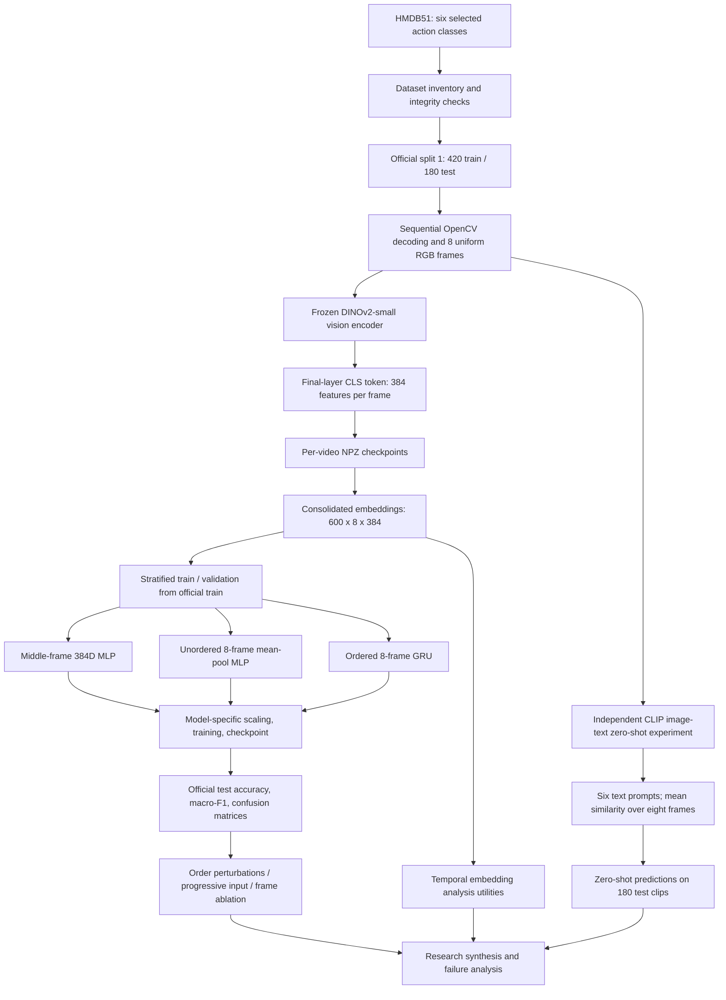
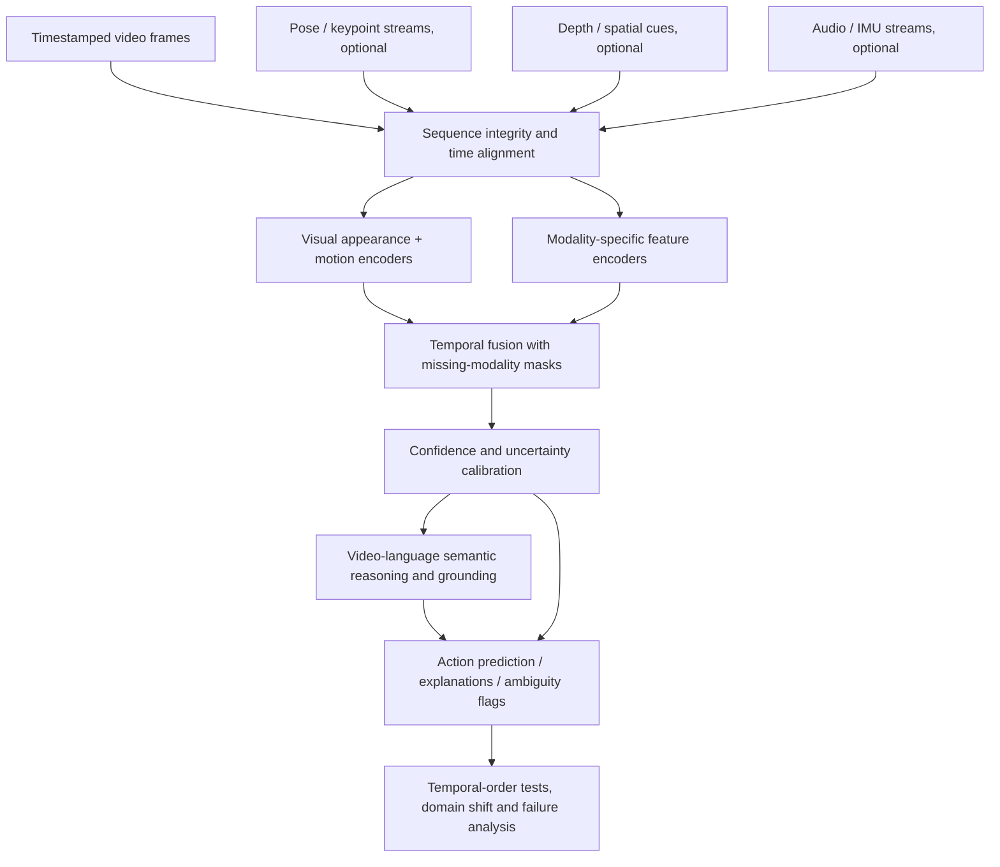

# Temporal & Multimodal Visual Intelligence — System Architecture

## 1. Research purpose

This prototype tests whether a sequence of visual observations improves recognition of six HMDB51 actions and, more specifically, whether **chronological ordering** adds predictive value beyond access to multiple independent visual observations. It uses a frozen image representation rather than learning video features end to end.

## 2. Implemented experimental pipeline

### Implemented components

| Layer | Design | Reason |
|---|---|---|
| Dataset | HMDB51 `brush_hair`, `clap`, `drink`, `eat`, `pour`, `wave`; official split 1 | Real ordered human actions with a fixed test protocol |
| Sequence acquisition | Count decodable frames; select eight uniformly spaced indices; decode sequentially; BGR-to-RGB | Fixed-length observations covering each clip; avoids relying only on container metadata |
| Encoder | Frozen `facebook/dinov2-small`, final hidden-state CLS token | Share a pretrained 384D appearance representation across supervised models |
| Embedding cache | Per-video NPZ checkpoints and consolidated `(600, 8, 384)` float32 tensor | Reproducible, GPU-efficient classifier experiments |
| Single-frame baseline | MLP on middle frame, index 4 | Measures performance with one static observation |
| Unordered multi-frame baseline | MLP on mean of eight frame vectors | Measures benefit of multiple observations without chronological order |
| Sequential model | One-layer GRU, 128 hidden features and classifier head, ordered eight-frame input | Tests learnable temporal processing beyond pooling |
| Zero-shot text-image model | `openai/clip-vit-base-patch32`; six class prompts; average per-frame similarity scores | Distinct semantic baseline; **does not model chronological order** |
| Primary metrics | Accuracy and macro-F1 on 180 official test clips, class confusion | Balanced comparison with specific error analysis |
| Temporal controls | Reversal, ten random shuffles, two progressive-observation protocols, standardized frame ablation | Distinguish order sensitivity, observation coverage, and dependence on particular inputs |
| Visual robustness | Blur, Gaussian noise, brightness reduction, central spatial mask applied before DINOv2 | Evaluate dependence on image quality and local evidence |

### Evaluation design and interpretation safeguards

- **Official split is preserved.** The official training partition is divided into 336 training and 84 validation clips. The official 180-video test partition is reserved for evaluation.
- **Model-specific preprocessing is fit only on supervised training data.** The single-frame and mean-pooled MLPs standardize their respective video-level inputs. The GRU standardizes frame features using training frames. Each test path uses its corresponding saved scaler.
- **Shared visual representation, differing heads.** The three primary classifiers receive representations derived from the same DINOv2 embeddings, but their architectures are not exactly parameter-matched. Differences therefore suggest, rather than causally prove, that one modeling strategy is superior.
- **Two different progressive-observation studies are retained separately.** (A) First-K chronological prefixes, and (B) fixed, temporally spread indices. Each K is a separately trained GRU. These configurations also differ somewhat from the main GRU classification head.
- **Temporal-order interventions use the same trained GRU.** Reversed and shuffled inputs change frame ordering without changing the set of visual observations; shuffled-result variation is not a multi-seed training confidence interval.
- **Embedding-level ablation happens after standardization.** Setting one standardized frame vector to zero replaces it with training-mean features, not a blank image.
- **Image corruption and occlusion happen before embedding extraction.** They test the whole image-encoder-plus-classifier path.
- **CLIP is distinct from a temporal VLM.** It evaluates class prompt alignment using multiple independent frames and their averaged similarities; it cannot directly describe temporal transitions.

## 3. Proposed larger multimodal perception system (not implemented)

The assessment asks for a conceptual architecture beyond the current prototype. The following is a **proposal**, not a claim that the described components were built.

**Design choices.** Appearance embeddings remain useful for object and scene context; motion features or pose trajectories should encode change. Time alignment prevents conflating modality lag with action order. Fusion should tolerate unavailable sensors; uncertainty estimates can surface ambiguous events. A true video-language layer could describe transitions and explain what new evidence appeared at later frames, unlike the present averaged CLIP score baseline.

## 4. Key experimental conclusion

Across 180 official test videos, the mean-pooling MLP scored **72.78% accuracy**, the GRU **71.67%**, and the single-frame MLP **69.44%**. The trained GRU also scored **71.78% mean accuracy** under ten shuffled input orders (71.67% in original order). These results support the practical value of gathering several visual observations, but **do not establish a reliable advantage from modeling their chronology** in this configuration. See `temporal_ai_research_report.pdf` for controls, caveats, and direct answers to the assessment's research questions.
